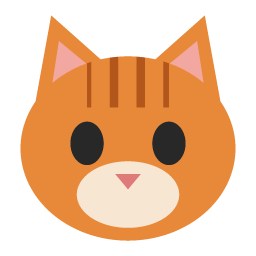
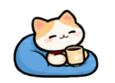
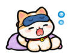
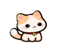
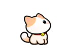

<div align="center">



# Desktop Pet

**A little cat that lives on your Windows desktop, wants you to look after it, and cheers on your focus sessions.**<br>
**แมวน้อยที่มาอยู่บนเดสก์ท็อป Windows ของคุณ รอให้คุณดูแล และคอยเชียร์ตอนคุณโฟกัสทำงาน**


[English](#english) · [ภาษาไทย](#thai)

</div>

## Meet the cat · รู้จักน้องแมว

Every animation below is rendered straight from the app's sprite sheets.<br>
ทุกท่าด้านล่างสร้างจาก sprite sheet ตัวเดียวกับที่แอปใช้จริง

<table align="center">
  <tr>
    <td align="center"><br><sub><b>idle</b><br>นั่งเล่น</sub></td>
    <td align="center"><br><sub><b>walk</b><br>เดินเล่น</sub></td>
    <td align="center"><br><sub><b>click</b><br>โดนจิ้ม</sub></td>
    <td align="center"><br><sub><b>drag</b><br>โดนอุ้ม</sub></td>
    <td align="center"><br><sub><b>land</b><br>ลงพื้น</sub></td>
  </tr>
  <tr>
    <td align="center"><br><sub><b>sleep</b><br>หลับปุ๋ย</sub></td>
    <td align="center"><br><sub><b>eat</b><br>กินข้าว</sub></td>
    <td align="center"><br><sub><b>happy</b><br>ดีใจ</sub></td>
    <td align="center"><br><sub><b>hungry</b><br>หิวแล้ว</sub></td>
    <td align="center"><br><sub><b>pet</b><br>โดนลูบหัว</sub></td>
  </tr>
  <tr>
    <td align="center"><br><sub><b>focus start</b><br>เริ่มโฟกัส</sub></td>
    <td align="center"><br><sub><b>focus done</b><br>โฟกัสครบ</sub></td>
    <td align="center"><br><sub><b>long break</b><br>พักยาว</sub></td>
    <td align="center"><br><sub><b>break over</b><br>หมดเวลาพัก</sub></td>
    <td></td>
  </tr>
  <tr>
    <td align="center"><br><sub><b>sad</b><br>เหงาจัง</sub></td>
    <td align="center"><br><sub><b>look</b><br>มองตามเมาส์</sub></td>
    <td align="center"><br><sub><b>stretch</b><br>บิดขี้เกียจ</sub></td>
    <td align="center"><br><sub><b>yawn</b><br>หาวง่วง</sub></td>
    <td></td>
  </tr>
  <tr>
    <td></td>
    <td align="center"><br><sub><b>jump</b><br>กระโดด</sub></td>
    <td align="center"><br><sub><b>fall</b><br>ร่วงลงมา</sub></td>
    <td align="center"><br><sub><b>climb</b><br>ปีนขอบจอ</sub></td>
    <td align="center"><br><sub><b>hang</b><br>เกาะผนัง</sub></td>
    <td></td>
  </tr>
</table>

---

<a name="english"></a>

## English

### What it does

**A desktop companion (v1)**

- 🪟 Sits in a transparent, always-on-top window. Clicks pass through everything except the
  cat itself, so it never gets in your way.
- 🖱️ Click it for a reaction, drag it anywhere, drop it and it lands. It remembers where you
  left it.
- 🚶 Wanders around now and then, and 💤 falls asleep after a few minutes without input.
- 🎮 Pauses when it is hidden or a fullscreen game or video is in front.
- ⚙️ Tray icon and settings: size, opacity, always on top, start with Windows, sleep delay.

**A pet to look after (v2)**

- 🏡 Adopt one cat and give it a name (1 to 20 characters, Thai works too).
- 🍗 **Hunger** and 💛 **happiness** go from 0 to 100 and drop slowly while the app runs. While
  the app is closed they drop much more slowly, and never below 30.
- 🥣 **Feed** it from the cat's right-click menu or the tray menu. A full cat politely
  refuses.
- ✋ **Pet** it by moving the mouse back and forth over it (no button), or pick "Pet" from
  its menu. Clicks cheer it up a little too.
- 🎭 Moods show in its behavior: hungry cats dream of food, sad cats wander less, happy cats
  sometimes celebrate when clicked.
- 🌱 Gentle by design: it never dies, never runs away and never nags.
- 🔍 Hover over the cat or the tray icon to see its name, needs and mood.

**A focus buddy (v3)**

- 🍅 A **Pomodoro-style focus timer** in the cat's menu and the tray menu: focus, short
  breaks, and a long break after every few sessions. Start, pause, resume, skip or stop.
- ⏱️ You set the minutes, how often the long break comes, and whether breaks and the next
  focus start on their own.
- 🐱 The cat keeps living its normal life, then reacts at each change: opens its laptop to
  start, shows off a medal when you finish, sips coffee on a long break, wakes from a nap
  when the break is over.
- 🔔 A Windows notification at the end of each phase (can be turned off), and today's 🍅
  count in the tooltips and settings.
- 🌏 **Thai or English**: pick the language in Settings; everything switches at once.

**A livelier cat (v4)**

- 👀 Turns to look at your mouse when it comes near, on either side, then goes back to
  what it was doing. Clicks still pass through the empty space around it.
- 🌅 Stretches when it wakes up in the morning, 🥱 yawns at night and falls asleep sooner.
- 😿 A sad cat now and then shows it, as a gentle hint to pet it.
- 📊 The last 7 days of focus sessions as small bars in Settings.
- 🍬 **Treats** (optional, off by default): each finished focus session earns one (up to 5).
  Give one from the menu for a little boost of hunger and happiness.
- 🔔 **Hungry reminder** (optional, off by default): one Windows notification when the cat is
  very hungry, at most every 4 hours.

**Up and down (v5)**

- 🪂 **Gravity**: drop the cat in the air and it falls down to the taskbar. You can catch it
  on the way down.
- 🪟 **Sits on your windows**: a falling cat lands on the top edge of an open window and
  strolls along it. It rides along when you move the window, and falls off when the window is
  minimized, maximized, closed or covered.
- 🦘 **Jumps and climbs** now and then: up onto a window in reach, down from its perch, or up
  the edge of the screen, where it hangs on for a few seconds and lets go.
- ⚙️ Each part can be turned off in Settings ("Fall down when dropped", "Land and sit on other
  windows", "Jump and climb now and then"). With gravity off the cat behaves like v4.

### Install

Build the installer (see Development) and run `dist/desktop-pet-setup-5.0.0.exe`. It
installs for your user only (no admin rights) and adds Start menu and desktop shortcuts.
Installing over an older version keeps your settings.

| | |
| --- | --- |
| Your data | `%APPDATA%\desktop-pet` (`settings.json`, `pet.json`, `focus.json` with your focus count for the last 30 days), removed on uninstall |
| Open settings | `"Desktop Pet.exe" --settings`, also while the app is running |
| Privacy | No network, no telemetry, no account. Nothing leaves your PC |
| Tested on | Windows 11, one monitor. Windows 10 is the target but untested |

### Development

You need Windows x64, Node.js 22.18 or newer (the `scripts/` tools rely on its built-in
TypeScript type stripping) and npm.

```bash
npm install
npm run dev
```

| Command | What it does |
| --- | --- |
| `npm run dev` | Run with hot reload. Uses `%APPDATA%\desktop-pet-dev`, never the installed app's data |
| `npm run build` | Production build into `out/` |
| `npm run typecheck` | vue-tsc and tsc for main, preload and `scripts/` |
| `npm run lint` | ESLint |
| `npm run test` | Vitest unit tests |
| `npm run dist` | Build plus the NSIS installer in `dist/` |
| `npm run icons:build` | Regenerate `resources/*.png` and `build/icon.ico` |
| `npm run sprite:prepare -- <in.png> <out.png> [cols] [rows]` | Clean a sprite sheet and print its cell boxes |
| `npm run sprite:regrid -- <in.png> <out.png> [scale] [cols] [rows] [--painted-background]` | Rebuild an off-spec sheet: clear a hazy background, cut frames by their art, 224 px grid, feet on one line. `--painted-background` first clears a "transparent" checkerboard painted into an opaque image |
| `npm run readme:art` | Re-render the animated README images in `docs/images/` |

Run `typecheck`, `lint` and `test` before committing.

<details>
<summary><b>Tech stack and project layout</b></summary>

- Electron with `contextIsolation`, no `nodeIntegration`, sandboxed preloads and one small
  typed API per window
- Vue 3 (Composition API, `<script setup>`) and strict TypeScript, built with electron-vite
- Canvas 2D drawing PNG sprite sheets, at most 30 frames per second and nothing in between
- Small JSON files for settings, pet data and the focus count, no database
- koffi (FFI) for one Windows call: detecting fullscreen apps
- electron-builder (NSIS), Vitest, ESLint, Prettier

```
src/main/        Electron main process: windows, tray, settings store, care and focus engines, IPC
src/preload/     one typed contextBridge API per window (pet, settings, adopt)
src/renderer/    Vue pages: the pet scene and state machine, settings, adoption
src/shared/      pure logic and types shared by main and renderer (needs, focus timer, strings, IPC)
assets/models/   sprite sheets, model config and the art license note
scripts/         icon generator, sprite prep and regrid tools, README image renderer
docs/images/     animated README previews (generated)
```

Pet-care tuning lives in `src/shared/careConfig.ts`, focus timer defaults in
`src/shared/focusConfig.ts`, and all UI text (English and Thai) in `src/shared/strings.ts`. Behavior is an explicit state machine in
`src/renderer/lib/petMachine.ts`.

</details>

---

<a name="thai"></a>

## ภาษาไทย

### ทำอะไรได้บ้าง

**เพื่อนบนเดสก์ท็อป (v1)**

- 🪟 อยู่ในหน้าต่างโปร่งใสที่ลอยอยู่บนสุดเสมอ คลิกทะลุได้ทุกที่ยกเว้นตัวแมว เลยไม่เกะกะการทำงาน
- 🖱️ คลิกแล้วน้องจะตอบสนอง ลากไปวางตรงไหนก็ได้ ปล่อยแล้วน้องจะกระโดดลงพื้น และจำตำแหน่งไว้ให้
- 🚶 เดินเล่นเองเป็นระยะ และ 💤 หลับเมื่อคุณไม่ได้แตะเครื่องสักพัก
- 🎮 หยุดพักเองเมื่อถูกซ่อน หรือเมื่อเปิดเกมหรือวิดีโอเต็มจอ
- ⚙️ มีไอคอนใน tray และหน้าตั้งค่า: ขนาด ความโปร่งใส ลอยบนสุด เปิดพร้อม Windows และเวลาก่อนหลับ

**สัตว์เลี้ยงให้ดูแล (v2)**

- 🏡 รับเลี้ยงแมวหนึ่งตัวและตั้งชื่อ (1 ถึง 20 ตัวอักษร ใช้ภาษาไทยได้)
- 🍗 **ความอิ่ม** และ 💛 **ความสุข** มีค่า 0 ถึง 100 ค่อย ๆ ลดลงตอนเปิดแอป ตอนปิดแอปจะลดช้ากว่ามาก และไม่ต่ำกว่า 30
- 🥣 **ให้อาหาร** จากเมนูคลิกขวาที่ตัวแมว หรือจากเมนู tray ถ้าน้องอิ่มแล้วจะไม่ยอมกิน
- ✋ **ลูบหัว** โดยขยับเมาส์ไปมาบนตัวน้อง (ไม่ต้องกดปุ่ม) หรือเลือก "Pet" จากเมนู การคลิกก็ช่วยให้น้องอารมณ์ดีขึ้นนิดหน่อย
- 🎭 อารมณ์แสดงออกผ่านท่าทาง: หิวจะฝันถึงชามข้าว เศร้าจะเดินเล่นน้อยลง มีความสุขจะดีใจเวลาโดนคลิก
- 🌱 ใจดีเป็นหลัก: น้องไม่มีวันตาย ไม่หนีหาย และไม่ตื๊อให้รำคาญ
- 🔍 ชี้เมาส์ค้างที่ตัวแมวหรือไอคอน tray เพื่อดูชื่อ ค่าความอิ่ม ความสุข และอารมณ์

**เพื่อนช่วยโฟกัส (v3)**

- 🍅 **ตัวจับเวลาโฟกัสแบบ Pomodoro** ในเมนูตัวแมวและเมนู tray: โฟกัส พักสั้น และพักยาวทุก ๆ กี่รอบ เริ่ม หยุดชั่วคราว ทำต่อ ข้าม หรือหยุดได้
- ⏱️ ตั้งนาทีเองได้ ตั้งได้ว่าพักยาวทุกกี่รอบ และจะให้เริ่มพักหรือเริ่มโฟกัสรอบถัดไปเองอัตโนมัติไหม
- 🐱 น้องแมวยังใช้ชีวิตตามปกติ แล้วเล่นท่าพิเศษตอนเปลี่ยนช่วง: เปิดแล็ปท็อปตอนเริ่ม โชว์เหรียญรางวัลตอนโฟกัสครบ จิบกาแฟตอนพักยาว ตื่นจากงีบตอนหมดเวลาพัก
- 🔔 แจ้งเตือน Windows ตอนจบแต่ละช่วง (ปิดได้) และดูจำนวน 🍅 ของวันนี้ได้ใน tooltip และหน้าตั้งค่า
- 🌏 **ภาษาไทยหรืออังกฤษ**: เลือกได้ในหน้าตั้งค่า เปลี่ยนแล้วมีผลทันที

**น้องแมวมีชีวิตชีวาขึ้น (v4)**

- 👀 หันมามองเมาส์เมื่อเมาส์เข้ามาใกล้ ได้ทั้งซ้ายและขวา แล้วกลับไปทำอย่างเดิมต่อ พื้นที่ว่างรอบตัวน้องยังคลิกทะลุได้เหมือนเดิม
- 🌅 ตื่นเช้ามาจะบิดขี้เกียจ 🥱 ตอนกลางคืนจะหาวและหลับเร็วขึ้น
- 😿 ถ้าน้องเหงา จะแสดงท่าเศร้าให้เห็นเป็นระยะ เหมือนบอกเบา ๆ ว่าอยากให้ลูบหัว
- 📊 ดูจำนวนรอบโฟกัสย้อนหลัง 7 วันเป็นกราฟแท่งเล็ก ๆ ในหน้าตั้งค่า
- 🍬 **ขนม** (เปิดเองได้ ค่าเริ่มต้นปิด): โฟกัสครบหนึ่งรอบได้ขนมหนึ่งชิ้น (เก็บได้สูงสุด 5) ให้น้องจากเมนูได้ ช่วยเพิ่มความอิ่มและความสุขนิดหน่อย
- 🔔 **เตือนเมื่อหิว** (เปิดเองได้ ค่าเริ่มต้นปิด): แจ้งเตือน Windows หนึ่งครั้งเมื่อน้องหิวมาก ไม่เกินทุก 4 ชั่วโมง

**ขึ้นสูงลงต่ำ (v5)**

- 🪂 **แรงโน้มถ่วง**: ปล่อยน้องกลางอากาศ น้องจะร่วงลงไปถึง taskbar คว้ากลางทางได้
- 🪟 **นั่งบนหน้าต่าง**: ตอนร่วงลงมา น้องจะเกาะขอบบนของหน้าต่างที่เปิดอยู่แล้วเดินเล่นบนนั้น ย้ายหน้าต่าง น้องก็ไปด้วย ถ้าหน้าต่างถูกย่อ ขยายเต็มจอ ปิด หรือมีหน้าต่างอื่นมาบัง น้องจะตกลงมา
- 🦘 **กระโดดและปีน** เป็นบางครั้ง: กระโดดขึ้นหน้าต่างที่อยู่ในระยะ กระโดดลงจากหน้าต่าง หรือปีนขอบจอขึ้นไปเกาะค้างไว้สักครู่แล้วปล่อยตัวลงมา
- ⚙️ ปิดแต่ละอย่างได้ในหน้าตั้งค่า ("ปล่อยแล้วตกลงพื้น" "ลงไปนั่งบนหน้าต่างอื่นได้" "กระโดดและปีนบ้างเป็นครั้งคราว") ถ้าปิดแรงโน้มถ่วง น้องจะทำตัวเหมือน v4

### ติดตั้ง

build installer ก่อน (ดูหัวข้อพัฒนาต่อ) แล้วรัน `dist/desktop-pet-setup-5.0.0.exe` ติดตั้งเฉพาะผู้ใช้ปัจจุบัน
ไม่ต้องใช้สิทธิ์ admin และสร้าง shortcut ให้ทั้งใน Start menu และบนเดสก์ท็อป ติดตั้งทับเวอร์ชันเก่าได้โดยการตั้งค่าเดิมยังอยู่

| | |
| --- | --- |
| ข้อมูลของคุณ | `%APPDATA%\desktop-pet` (`settings.json`, `pet.json`, `focus.json` ที่เก็บจำนวนรอบโฟกัสย้อนหลัง 30 วัน) ลบออกเมื่อถอนการติดตั้ง |
| เปิดหน้าตั้งค่า | `"Desktop Pet.exe" --settings` ใช้ได้แม้แอปเปิดอยู่ |
| ความเป็นส่วนตัว | ไม่ใช้เน็ต ไม่เก็บสถิติ ไม่มีบัญชี ข้อมูลไม่ออกจากเครื่อง |
| ทดสอบแล้วบน | Windows 11 จอเดียว (Windows 10 เป็นเป้าหมาย แต่ยังไม่ได้ทดสอบ) |

### พัฒนาต่อ

ต้องมี Windows x64, Node.js 22.18 ขึ้นไป (สคริปต์ใน `scripts/` ใช้การรัน TypeScript ที่ติดมากับ Node) และ npm

```bash
npm install
npm run dev
```

คำสั่งทั้งหมดอยู่ในตารางหัวข้อ [Development](#development) ด้านบน ก่อน commit ให้รัน `typecheck`, `lint` และ `test` ทุกครั้ง
ค่าที่ใช้จูนระบบเลี้ยงอยู่ที่ `src/shared/careConfig.ts` ค่าตั้งต้นของตัวจับเวลาอยู่ที่ `src/shared/focusConfig.ts` และข้อความทั้งหมด (ไทยและอังกฤษ) อยู่ที่ `src/shared/strings.ts`

---

## Documents · เอกสาร

| | |
| --- | --- |
| [requirement.md](requirement.md) | v1 requirements, architecture, measurements |
| [requirement-v2.md](requirement-v2.md) | Pet-care system, acceptance criteria, open questions |
| [requirement-v3.md](requirement-v3.md) | Focus timer and Thai/English UI |
| [requirement-v4.md](requirement-v4.md) | Livelier cat, focus history and treats, hungry reminder |
| [requirement-v5.md](requirement-v5.md) | Gravity, window perches, jump and climb |
| [WORK-LOG.md](WORK-LOG.md) | Progress log and where to resume |
| [CLAUDE.md](CLAUDE.md) · [AGENTS.md](AGENTS.md) | Working rules for coding agents |

## Art · ภาพ

The cat sprites were generated by the project owner with Claude (claude.ai); no third-party
artwork is included. See [cat-sprite.LICENSE.txt](assets/models/cat-sprite.LICENSE.txt).<br>
ภาพแมวสร้างโดยเจ้าของโปรเจกต์ด้วย Claude (claude.ai) ไม่มีภาพจากบุคคลอื่น

<div align="center">
<sub>v5.0.0 · personal project, not distributed · โปรเจกต์ส่วนตัว ไม่ได้แจกจ่าย</sub>
</div>
